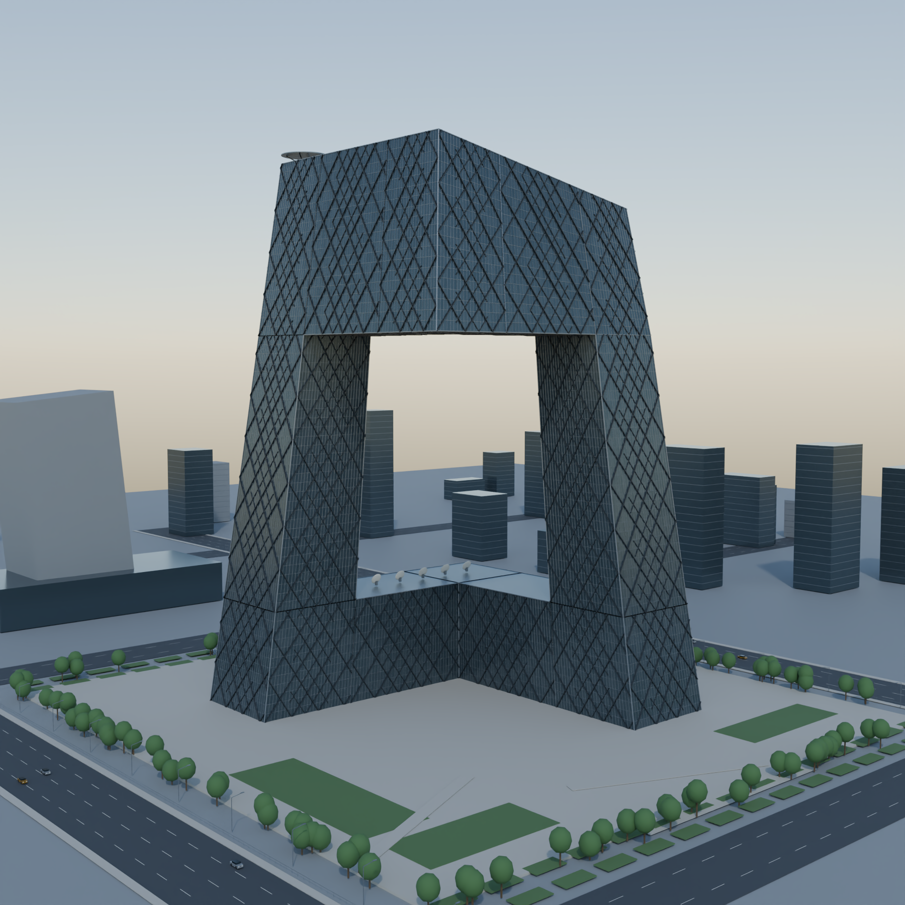
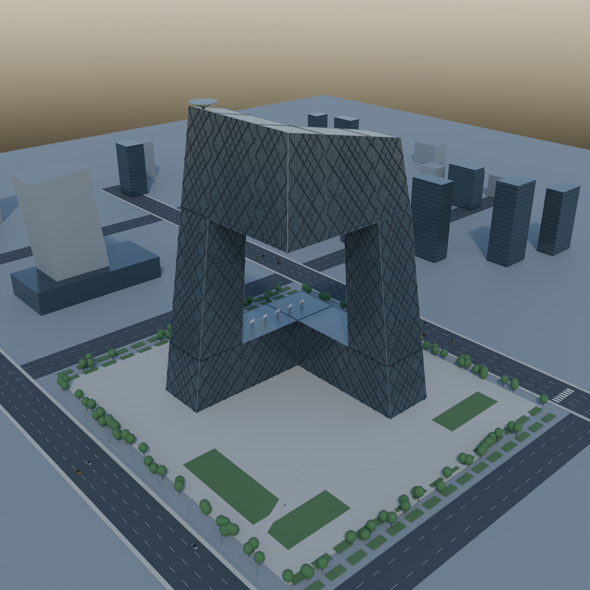
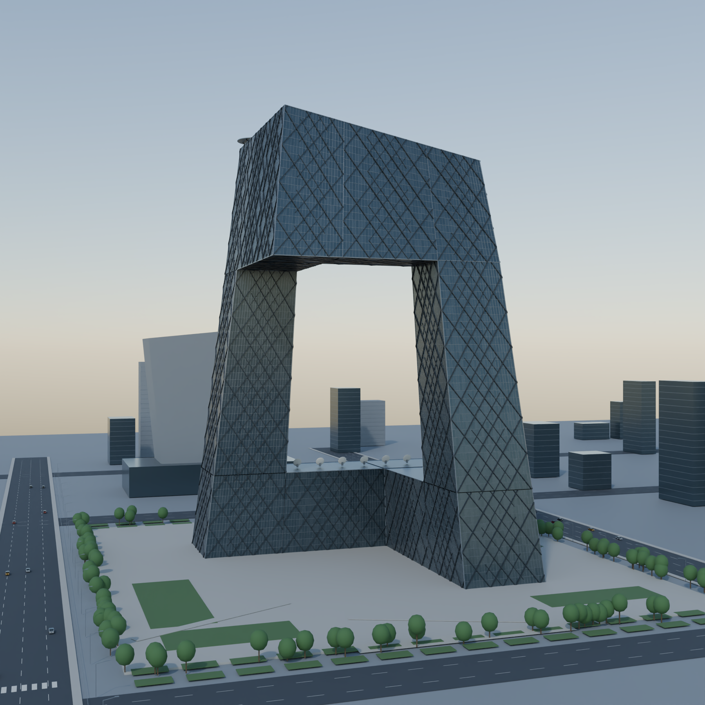
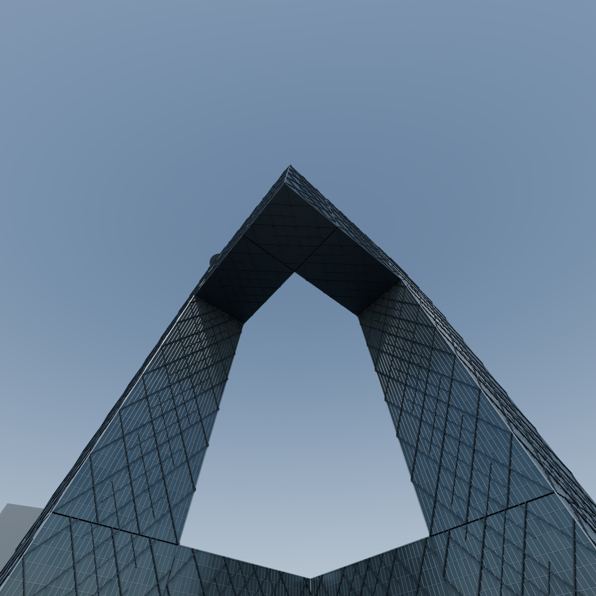

# CCTV Headquarters 外观模型

使用 Blender 4.3.2 无头模式和 bpy 生成的中央电视台总部大楼参数化外观重建。

## 下载

- [下载完整交付包（约 10 MB）](https://github.com/wikipiggy/CCTV/raw/refs/heads/main/output/CCTV_download.zip)：包含 Blender 模型、生成脚本、说明及四张 1800×1800 渲染图。
- [单独下载 Blender 模型](https://github.com/wikipiggy/CCTV/raw/refs/heads/main/output/CCTV_Headquarters.blend)
- [查看 bpy 主脚本](output/build_cctv.py)
- [建模说明与精度限制](output/README_zh.md)

## 渲染

### 正面

### 俯视

### 右侧

### 悬挑仰视

主体外壳标高为 234 m。水平尺寸、斜撑节点及周边环境包含估算与简化；这是一份参考图重建模型，不是测绘级或照片级复刻。
